# azure-boutique-aks

Google's Online Boutique (11 microservices) running on **Azure Kubernetes Service**, built by hand in the Azure portal so every resource was configured and understood, then automated with a **GitHub Actions** pipeline.

What it shows:

- **Networking:** custom VNet with separate subnets for management and the cluster, an NSG that allows SSH only from my IP, AKS on Azure CNI Overlay with the Calico network policy engine
- **Containers:** Azure Container Registry attached to AKS through managed identity (no registry password in the cluster)
- **CI/CD:** GitHub Actions builds two services, pushes them to ACR and rolls them out to AKS, with automatic rollback when a rollout fails; Azure login uses OIDC, so no Azure secret is stored in GitHub
- **Secrets:** a Key Vault secret mounted into a pod through AKS Workload Identity, with a read-only role
- **Monitoring:** an Azure Monitor metric alert on pending pods that emails me through an action group
- **Cost control:** everything lives in one resource group that is deleted after each session

> The cluster is not running permanently. Everything here was built, tested and screenshotted in sessions, then deleted to keep the cost at a few dollars of credit.

## Architecture

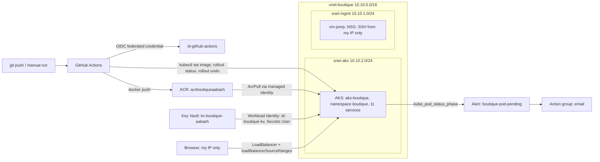

## Azure resources

All in resource group `rg-boutique`, region Central India.

| Resource | Name | Key settings |
|---|---|---|
| Virtual network | `vnet-boutique` | `10.10.0.0/16`, subnets `snet-mgmt` (`10.10.1.0/24`) and `snet-aks` (`10.10.2.0/24`) |
| Network security group | `nsg-mgmt` | Associated with `snet-mgmt`, inbound SSH allowed only from my public IP |
| Virtual machine | `vm-jump` | Ubuntu 24.04, `Standard_B2ats_v2`, SSH key login, used to practise VNet/NSG setup |
| Container registry | `acrboutiqueaakash` | Basic tier, attached to AKS (AcrPull for the cluster's kubelet identity) |
| AKS cluster | `aks-boutique` | Kubernetes 1.36, Free tier, one 2-vCPU D-series node, manual scaling, Azure CNI Overlay in `snet-aks`, Calico, OIDC issuer and Workload Identity on |
| Managed identity | `id-aks-boutique` | Cluster identity for the bring-your-own VNet |
| Managed identity | `id-github-actions` | Federated credential for this repo's `main` branch; AcrPush on the registry, AKS Cluster User Role on the cluster |
| Key Vault | `kv-boutique-aakash` | Azure RBAC permission model, 7-day soft delete, secret `demo-api-key` |
| Managed identity | `id-boutique-kv` | Federated credential for service account `boutique/kv-reader`; Key Vault Secrets User (read only) |
| Action group | `ag-boutique-email` | Email notification |
| Metric alert | `boutique-pod-pending` | Number of pods by phase, `phase = Pending`, `namespace = boutique`, average > 0 over 5 minutes, severity 2 |

## CI/CD pipeline

Workflow: [`.github/workflows/deploy.yml`](.github/workflows/deploy.yml)

1. **Azure login (OIDC):** GitHub issues a short-lived token; Entra ID trusts it through the federated credential on `id-github-actions`. The repo only stores the client, tenant and subscription IDs.
2. **Build and push:** `frontend` (Go) and `cartservice` (.NET) are built with Docker on the runner and pushed to ACR, tagged with the run number.
3. **Deploy:** `kubectl set image` on each deployment, then `kubectl rollout status` with a 180-second timeout.
4. **Auto-rollback:** if the rollout does not finish, the pipeline runs `kubectl rollout undo` and fails the run, so a bad image never replaces a working one.

It runs on pushes to `main` that touch the service code or the workflow, and manually with two inputs: which service to build, and an optional existing image tag to deploy (used for the rollback demo).

**Rollback demo:** a manual run with `image_tag = doesnotexist` failed the rollout, the pipeline rolled `frontend` back to the previous revision, and the shop stayed up the whole time because the old pod was never removed.

## Key Vault with Workload Identity

[`k8s/keyvault/kv-demo.yaml`](k8s/keyvault/kv-demo.yaml) creates:

- a service account `kv-reader` annotated with the client ID of `id-boutique-kv`
- a `SecretProviderClass` for the Azure Key Vault provider (secrets store CSI driver add-on)
- a test pod that mounts `demo-api-key` at `/mnt/secrets`

The pod proves its identity with a projected service account token, Entra ID matches it to the federated credential (`system:serviceaccount:boutique:kv-reader`), and the read-only role lets it fetch the secret. No password or key appears in any file.

## Monitoring

The alert watches the AKS platform metric `kube_pod_status_phase`, split by `phase = Pending` and `namespace = boutique`. It would have caught the real scheduling problem hit during the build (see below). It was tested with [`k8s/monitoring/pending-test-pod.yaml`](k8s/monitoring/pending-test-pod.yaml), a pod that asks for 4 vCPU on a 2-vCPU node: the alert fired and the email arrived within minutes.

## Problems and fixes

| Problem | Cause | Fix |
|---|---|---|
| No small VM sizes available in the portal | Size list filtered by availability zone and subscription restrictions | Set availability to "No infrastructure redundancy" and chose `Standard_B2ats_v2` |
| AKS default node size unavailable, B-series rejected | `Standard_DS2_v2` not offered to this subscription; AKS system pools do not allow B-series | Chose a 2-vCPU D-series size |
| Default node pool would exceed quota | Regional limit of 4 vCPUs; the default pool autoscales 2 to 5 nodes | One node, manual scaling, no availability zones |
| `az acr build` failed with `TasksOperationsNotAllowed` | ACR Tasks are not allowed on this subscription | First deploy used `az acr import` of the upstream images; real builds moved to GitHub Actions runners |
| Most pods stuck in `Pending` | AKS system pods (Calico, CoreDNS, metrics-server and others) left too little of the node's 1.9 allocatable vCPUs; a resource change also left old and new pods side by side | Lowered CPU requests to 10m (limits unchanged), scaled deployments to 0 and back to 1 |
| Cloud Shell web preview stuck on sign-in | Browser cookie handling for the preview proxy | Exposed `frontend` as a LoadBalancer restricted to my IP with `loadBalancerSourceRanges` |
| Federated credential needed numeric IDs | Repos created after July 2026 get immutable OIDC subjects (`owner@id/repo@id`) | Added the owner ID and repository ID to the credential |
| Pipeline failed at "Get AKS credentials" | `id-github-actions` had AcrPush but no cluster role | Added Azure Kubernetes Service Cluster User Role on the cluster |
| "Operation not allowed by RBAC" on Key Vault secrets | Subscription Owner does not include Key Vault data access; the role had been given to the wrong identity | Removed it from `id-github-actions` and gave Key Vault Secrets Officer to my own account |
| Alert action group creation failed | `Microsoft.Insights` resource provider not registered on a new subscription | `az provider register --namespace Microsoft.Insights` |

## Notes and limitations

- The pipeline deploys with `kubectl set image`, so the manifest in `k8s/` still references the first images (`:v1`). Re-applying it would roll the two services back to those images.
- The cluster uses local accounts with Kubernetes RBAC, so the pipeline's kubeconfig has full cluster access. A next step is Microsoft Entra ID authentication with Azure RBAC, scoped to the `boutique` namespace.
- `frontend` was exposed with a `kubectl patch` to a LoadBalancer limited to my IP; the manifest keeps it as ClusterIP.
- The Key Vault part is a demo secret read by a test pod; the shop services themselves do not use it.
- The GitHub secrets point to an identity that is deleted between sessions, so pipeline runs fail at login until the environment is rebuilt.

## Screenshots

| | |
|---|---|
| Resource group | 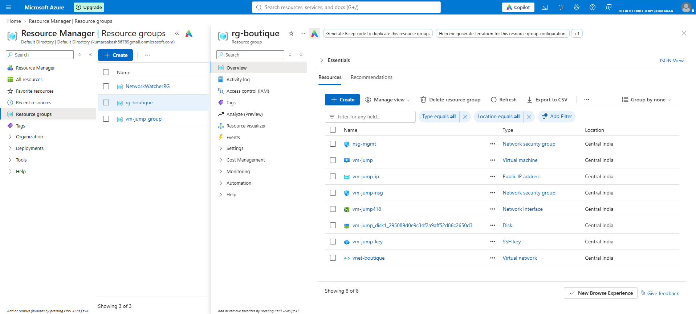 |
| VNet subnets | 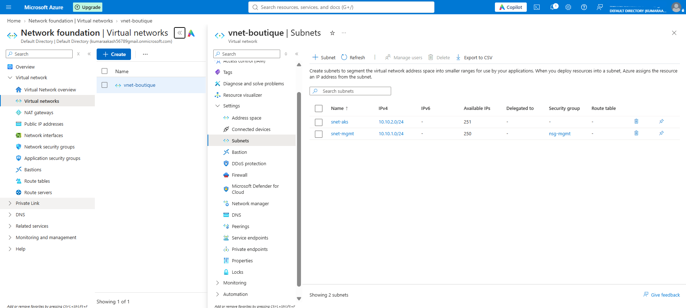 |
| NSG inbound rules | 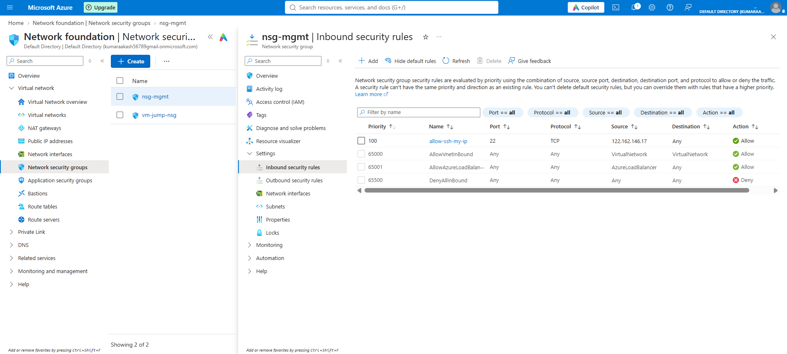 |
| Jump VM | 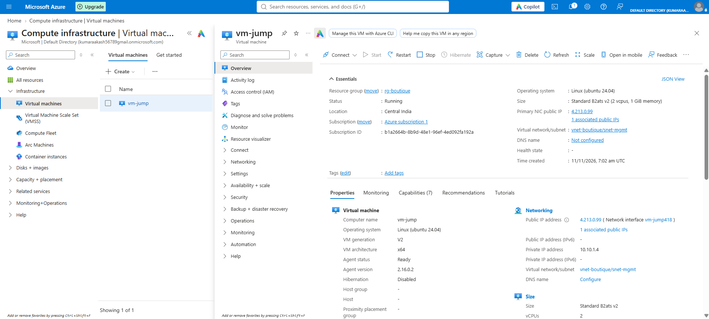 |
| SSH login | 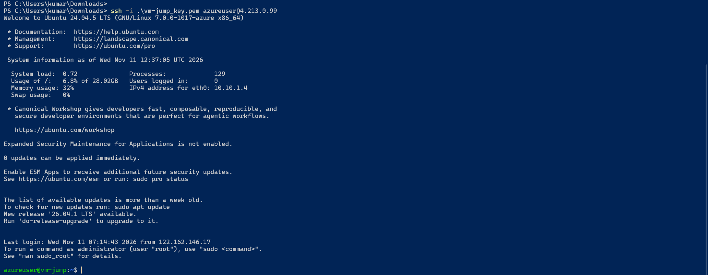 |
| AKS overview | 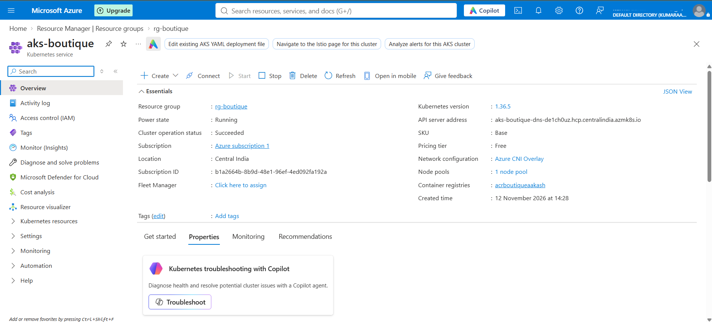 |
| Node pool | 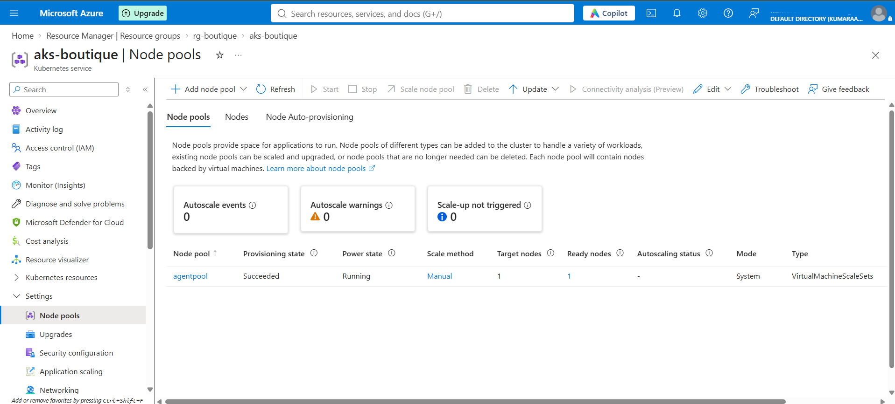 |
| Pods running | 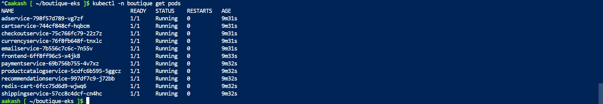 |
| Shop home page | 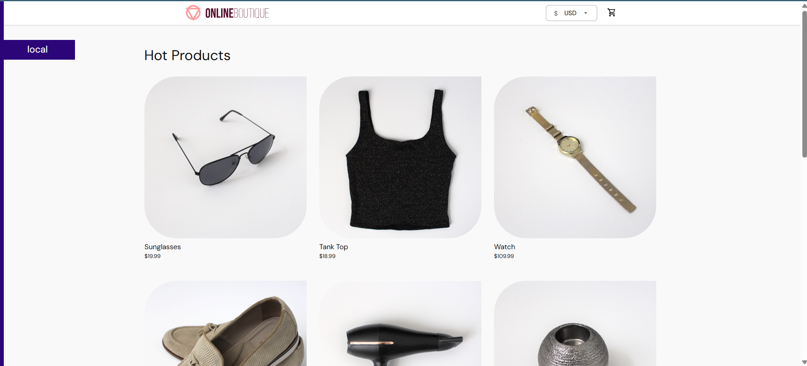 |
| Order placed | 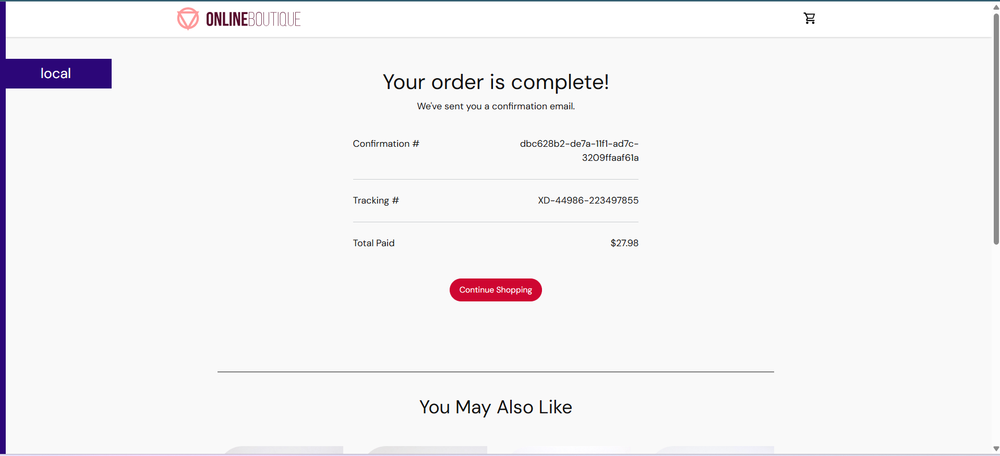 |
| ACR repositories | 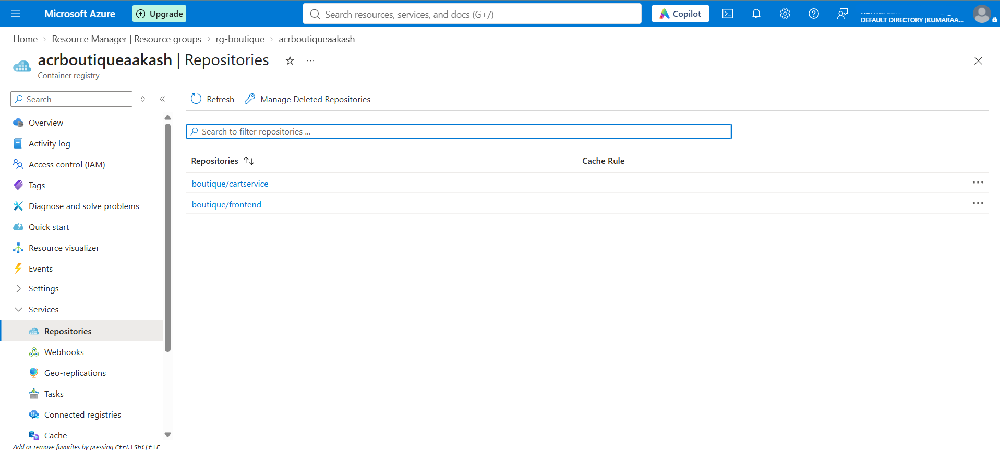 |
| Frontend LoadBalancer | 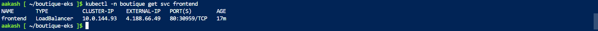 |
| Pipeline run | 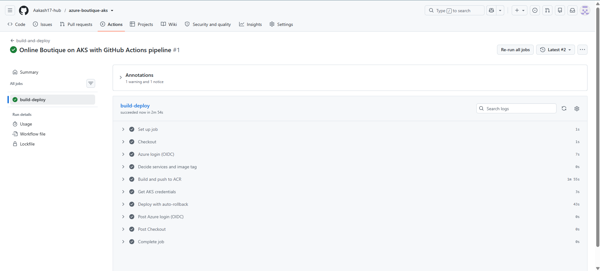 |
| Images deployed by the pipeline | 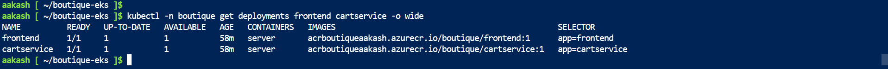 |
| Rollback demo | 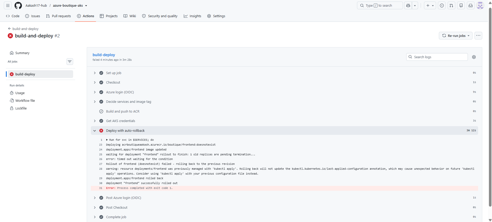 |
| Key Vault secret | 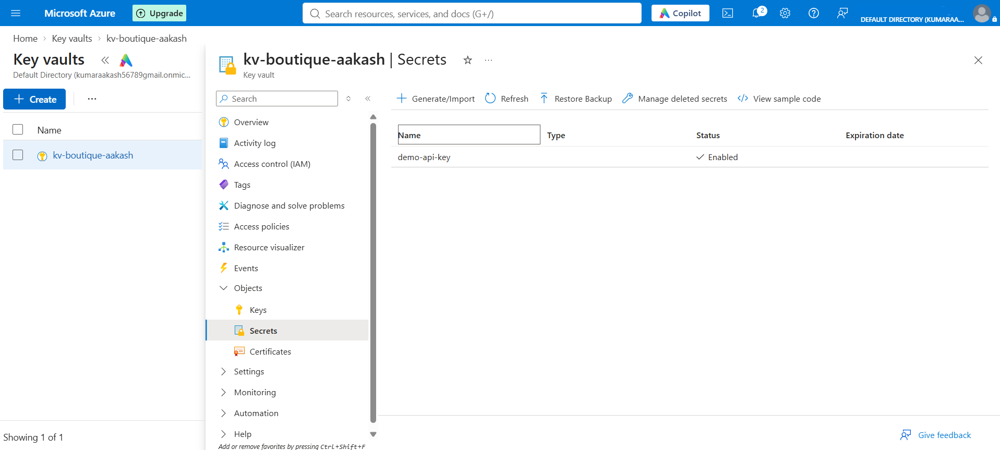 |
| Pod reads the secret | 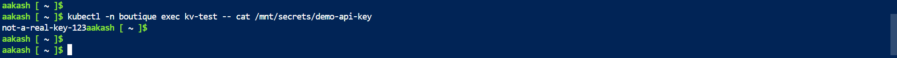 |
| Alert condition | 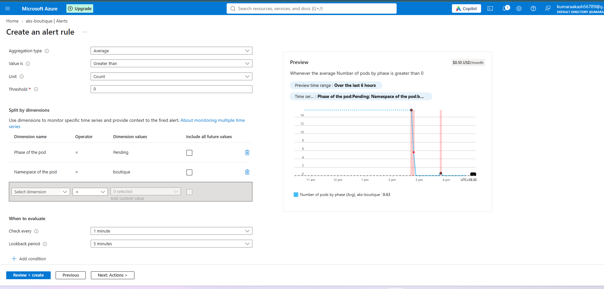 |
| Alert fired | 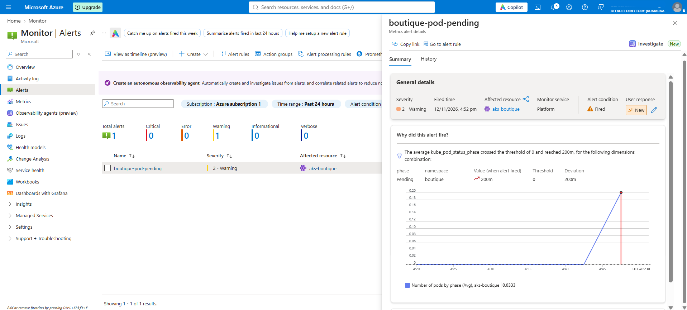 |
| Alert email | 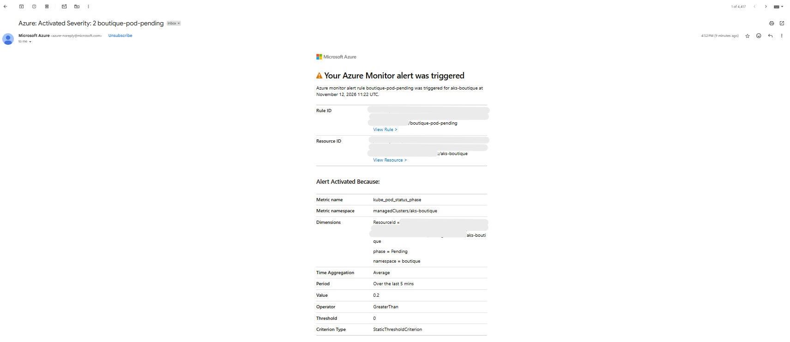 |

## Repository layout

| Path | Contents |
|---|---|
| `frontend/`, `cartservice/` | Source of the two services the pipeline builds (from Online Boutique) |
| `k8s/namespace.yaml` | `boutique` namespace |
| `k8s/kubernetes-manifests.yaml` | All 11 services; frontend and cartservice images point to ACR, CPU requests lowered to 10m to fit one node, loadgenerator at 0 replicas |
| `k8s/keyvault/kv-demo.yaml` | Workload Identity service account, SecretProviderClass and test pod |
| `k8s/monitoring/pending-test-pod.yaml` | Unschedulable pod used to test the alert |
| `.github/workflows/deploy.yml` | Build, push to ACR, deploy to AKS with rollback |
| `docs/screenshots/` | Build-log screenshots |

## Cleanup

```
az group delete -n rg-boutique --yes --no-wait
az keyvault purge --name kv-boutique-aakash
```

Deleting the resource group also removes the cluster's node resource group (`MC_rg-boutique_aks-boutique_centralindia`), the load balancer and its public IP.

## Related projects

- [boutique-eks](https://github.com/Aakash17-hub/boutique-eks): the same app on Amazon EKS with a GitLab, Jenkins and ECR pipeline
- [shopsphere](https://github.com/Aakash17-hub/shopsphere): Online Boutique on Kubernetes with RBAC, NetworkPolicies, Prometheus and Grafana
- [devops-lab-infra](https://github.com/Aakash17-hub/devops-lab-infra): segmented AWS lab with Terraform, Jenkins blue-green deploys and GitLab CI

## Credits

Application code and base manifests: [Online Boutique](https://github.com/GoogleCloudPlatform/microservices-demo) by Google, Apache License 2.0 (see `LICENSE`). Azure infrastructure, manifest changes, the pipeline, the Key Vault and monitoring setup are my own work.
